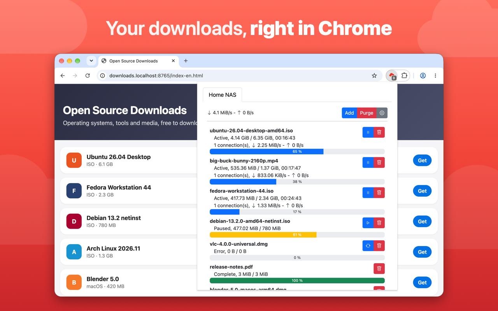
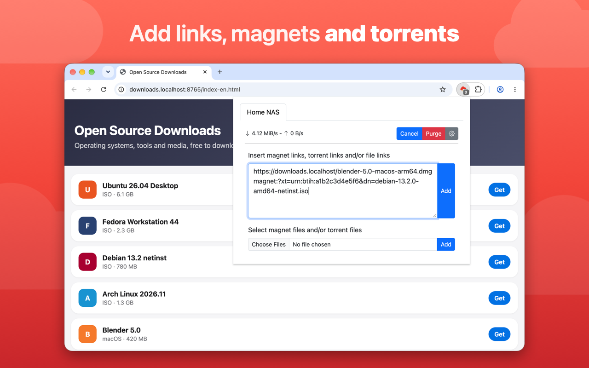
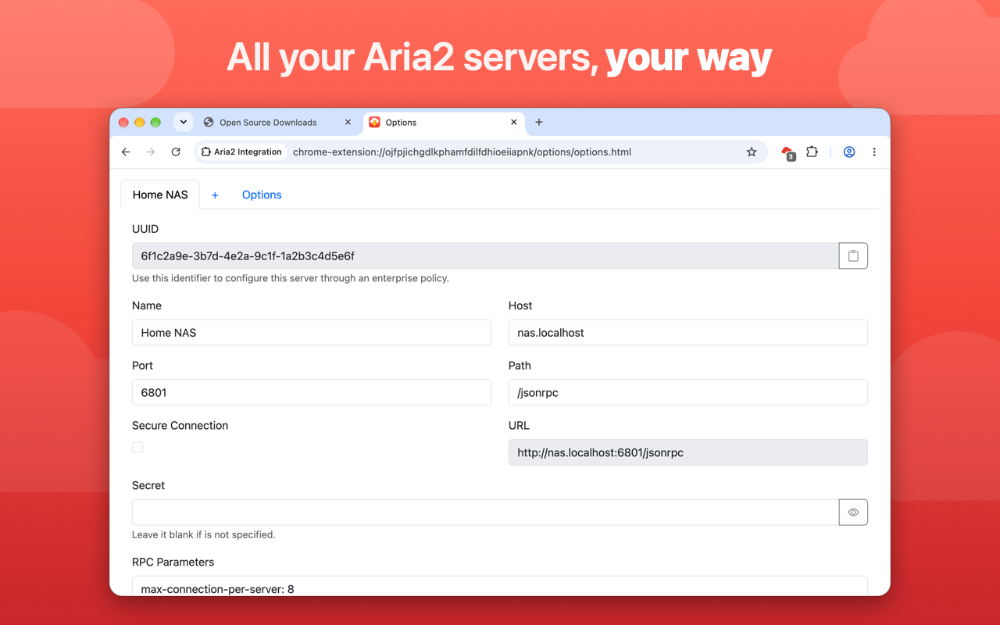

<h3 align="center">Aria2 Integration</h3>

    Send links, selected text, torrents and browser downloads to your Aria2 server or Motrix, and follow every download from your browser.

    

    
    

## Install

- [Safari on iPhone, iPad and Mac (App Store)](https://apps.apple.com/app/aria2-integration/id6476014369)
- [Firefox Add-ons](https://addons.mozilla.org/firefox/addon/aria2-extension/)
- [Chrome Web Store](https://chrome.google.com/webstore/detail/aria2-integration/hnenidncmoeebipinjdfniagjnfjbapi)
- [Microsoft Edge Add-ons](https://microsoftedge.microsoft.com/addons/detail/aria2-integration/hmmpdilndjfmceolhbgjejogjaglbiel)

## Features

### Send downloads
- "Download with Aria2" in the context menu of links and selected text
- Add links and magnet links from the popup
- Add torrent and metalink files from your device
- Capture browser downloads and send them to Aria2 instead (Firefox, Chrome and Edge), with exclusions by protocol, site, file type or minimum size
- Share extension: send a link, magnet link or torrent file from any app (iPhone, iPad and Mac)

### Follow and control
- Active, waiting, paused, completed and failed downloads
- Progress, speed, time remaining and connections for each download
- Pause, resume, retry or remove a download, or clear all finished downloads
- The number of active downloads on the toolbar icon
- Notifications when a link or file is added, or when something goes wrong (Firefox, Chrome and Edge)

### Your servers
- As many Aria2 servers or Motrix instances as you need
- Secure connections and secret token support
- Default RPC parameters for each server, such as the download folder or a speed limit
- Servers and settings can be deployed through an enterprise policy (Firefox, Chrome and Edge)

### Private browsing
- Different RPC parameters for downloads sent from a private window
- Finished downloads cleared from the server automatically

### Appearance
- Light, dark or automatic theme

## Requirements

Aria2 Integration controls an Aria2 server; it does not download files itself. You need Aria2 running with RPC enabled, or Motrix, reachable from your device.

## Privacy

Aria2 Integration only talks to the Aria2 servers you add. No account, no tracking, no data collection.

## Repository

This repository gathers the extension's sources and its store assets.

| Path | Contents |
|---|---|
| [`aria2-integration`](https://github.com/baptistecdr/aria2-integration) | The web extension for Firefox, Chrome and Edge (submodule) |
| [`aria2-integration-safari`](https://github.com/baptistecdr/aria2-integration-safari) | The Safari app and extensions for iPhone, iPad and Mac (submodule) |
| `icons` | The app icon (`AppIcon.icon`), the browser and toolbar icons as SVG, and their PNG exports |
| `images/Apple` | App Store screenshots (iPhone 6.3", iPhone Duo, iPad 13", Mac) and product page images |
| `images/Firefox/AMO` | Firefox Add-ons screenshots |
| `images/Chrome/CWS` | Chrome Web Store screenshots and promo tiles |
| `images/Edge/Store` | Edge Add-ons screenshots, logo and promo tiles |
| `metadata` | Store descriptions, summaries, screenshot captions and review notes, per store and language |

Store images and texts come in English (`en`, `en-US`) and French (`fr`, `fr-FR`).
